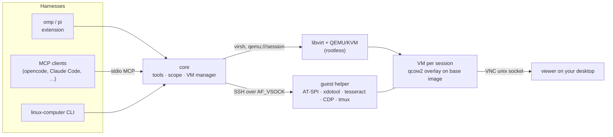

# linux-computer

[](https://github.com/mayask/linux-computer/actions/workflows/ci.yml)

Give every coding-agent session its own local Linux desktop VM, and let the agent drive it end to end — apps, browsers, terminals, system UI — mostly through text, while you watch the same screen and step in when you agree to.

- **One VM per session, on demand.** The first `vm_*` call clones a golden Debian 13 + XFCE image (copy-on-write, a few seconds). Subagents share their parent's VM; other sessions never see it.
- **Persistent until you destroy it.** The disk survives everything; running state survives turns and harness restarts. When the session ends the VM is suspended to disk and resumes exactly where it was, apps still open.
- **Text first.** The screen is read as an AT-SPI accessibility tree (GTK, Qt, Firefox, Chromium, WebKit), OCR for canvases, DOM for Chromium, full terminal scrollback. Screenshots only when appearance matters, so text-only models work and vision models spend fewer tokens.
- **Never headless.** The VM has a real display. A viewer window shows it live on your desktop; you and the agent take turns through an explicit hand-off, so input never clashes.
- **Harness-agnostic.** One core, three front doors: an omp/pi extension (exact per-session scoping), an MCP server (opencode, Claude Code, Codex, Cursor, …) and a CLI.

## How it works



- **VMs** run in the user's own libvirt session (`qemu:///session`): no root, no system services. Each VM is a qcow2 overlay on a read-only base image under `~/.local/share/linux-computer/`.
- **No network ports.** The host reaches the guest over AF_VSOCK (libvirt's ssh proxy or a built-in fd-passing fallback). One multiplexed SSH connection per VM keeps calls around 0.3 s. The guest gets outbound internet through passt.
- **Guest helper** (`guest/linux_computer.py`) is uploaded on first use and replaced when it changes. It reads the accessibility tree, injects X11 input, runs OCR, talks to Chromium's DevTools endpoint and captures terminals.
- **Scope.** omp and pi pass the session to the extension; the VM belongs to the top-level session (subagent transcripts live under the parent's directory, so they map to the parent). MCP has no session identity, so the MCP server scopes by `LINUX_COMPUTER_SCOPE` or, if that is unset, by project directory.

### Harness support

| Harness | Integration | VM scope |
|---|---|---|
| omp | extension (`omp.extensions`), `/vm` command, status line | per top-level session; subagents share it |
| pi | extension (`pi.extensions`), `/vm` command, status line | per session |
| opencode, Claude Code, Codex, Cursor, … | MCP server: `linux-computer mcp` | `LINUX_COMPUTER_SCOPE`, else project directory |
| scripts / other agents | `linux-computer tool <name> '<json>'` | `LINUX_COMPUTER_SCOPE`, else project directory |

## Requirements

Host (Linux):

- KVM (`/dev/kvm`), libvirt with QEMU and passt (`virsh`, `qemu-img`)
- `genisoimage`, `mkisofs` or `xorriso` (only to build the base image)
- OpenSSH client, Python 3 (vsock proxy fallback), Node.js 22+
- A VNC viewer for watching; the default is TigerVNC `vncviewer` (`viewerCommand` to change)

Fedora: `sudo dnf install libvirt-daemon-kvm qemu-kvm passt genisoimage tigervnc`
Debian/Ubuntu: `sudo apt install libvirt-daemon-system qemu-system-x86 qemu-utils passt genisoimage tigervnc-viewer`

The guest is built automatically from the official Debian 13 cloud image (checksum-verified) the first time a VM is needed, in about two minutes. Build it ahead of time with `linux-computer base build`.

## Install

```bash
git clone https://github.com/mayask/linux-computer.git ~/src/pi-linux-computer
cd ~/src/pi-linux-computer && npm install   # builds dist/ for the CLI and MCP server
npm link                                    # optional: puts `linux-computer` on PATH
```

**omp** — add the package directory to `~/.omp/agent/config.yml`:

```yaml
extensions:
  - ~/src/pi-linux-computer
```

**pi** — `pi install ~/src/pi-linux-computer`, then `/reload`.

**opencode** — `opencode.json`:

```json
{ "mcp": { "linux-computer": { "type": "local", "command": ["linux-computer", "mcp"] } } }
```

**Claude Code** — `claude mcp add linux-computer -- linux-computer mcp`

**Any MCP client** — stdio server `linux-computer mcp` (or `node ~/src/pi-linux-computer/dist/cli.js mcp`). Set `LINUX_COMPUTER_SCOPE` in the server's environment to separate VMs beyond one-per-project.

## Tools

| Tool | Purpose |
|---|---|
| `vm_lifecycle` | `status`, `start`, `view`, `suspend`, `stop`, `restart`, `snapshot`/`revert`/`snapshots`/`delete_snapshot`, `usb_list`/`usb_attach`/`usb_detach`, `destroy` (needs `confirm`) |
| `vm_control` | Hand input to the user (`to=user`, optional `waitSeconds`) and back (`to=agent`), or `status` |
| `vm_observe` | Accessibility tree as compact text; filters `app`, `window`, `focusedWindow`, `find` |
| `vm_act` | `click`, `double_click`, `right_click`, `invoke`, `focus`, `set_text`, `type`, `key`, `scroll`, `move`, `drag`, `wait` |
| `vm_screen_text` | OCR of the screen or a region, with bounds for clicking |
| `vm_screenshot` | PNG of the screen (hypervisor capture) or a region |
| `vm_exec` | Bash as `agent` with the desktop environment set; `background=true` for GUI apps and servers |
| `vm_copy` | Stream files/directories host ↔ VM |
| `vm_browser` | Chromium via DevTools: `open`, `navigate`, `text`, `elements`, `click`, `fill`, `eval`, `tabs`, `activate`, `close` |
| `vm_terminal_capture` | Last command and its full output from a visible terminal, without rerunning it |
| `vm_secrets` | List stored credentials (names, usernames, where they may be used; never values) |

Every tool also takes `target` to address an external SSH machine from the config instead of the session VM.

The bundled `linux-computer` skill and the MCP server instructions teach the agent the text-first order and the hand-off protocol.

## Credentials without exposing them to the agent

The agent can log into sites and apps in the VM with credentials it never sees. You store them on the host; the agent only uses them by name.

```bash
linux-computer secret add github --username maxim --origin https://github.com          # value prompted, hidden
linux-computer secret add github/otp --kind totp --origin https://github.com           # base32 seed; fills the current code
linux-computer secret add gh-token --kind token --exec                                  # usable as an env var in vm_exec
linux-computer secret add vpn --app nm-connection-editor                                # typed into a native app
linux-computer secret list | approvals | rm <name> | revoke <name> [--scope S]
```

- **Storage:** values are in the GNOME keyring (`secret-tool`, attributes `service=linux-computer name=<name>`); `~/.config/linux-computer/secrets.json` holds only metadata.
- **Use:** `vm_browser fill secret=<name>` (Chromium), `vm_act type secret=<name> nodeId=…` (native apps), `vm_exec secretEnv={"VAR": "<name>"}`. The host looks up the value and sends it to the guest helper over the SSH stdin channel: not in tool arguments, process arguments or files.
- **Binding:** a secret is filled only on its listed origins (checked again in the same step as the fill, on the field's own document), typed only into editable fields of its listed apps, and given to shell commands only with `--exec`.
- **Approval:** the first use per VM and place asks you in the harness (omp/pi dialog, MCP elicitation). Without a dialog the call is refused and tells you the `linux-computer secret approve …` command to run. `--scope '*'` pre-approves for every VM.
- **Scrubbing:** every tool result, detail, progress message and error is scrubbed of all stored values and their base64, hex, URL, JSON-escaped and reversed forms, shown as `«secret:name»`. `vm_browser eval` is refused on a page after a secret was filled into it, `elements` never shows password values, and the browsers' password managers are disabled in the image.

What it does not stop: a deliberately malicious agent with shell access can still use the logged-in session (cookies) and could exfiltrate a value in a form the scrubber does not know. Use dedicated or narrowly scoped accounts and tokens. Screenshots are not scrubbed. Native GTK4 password entries expose their text over accessibility, so their content is visible to `vm_observe` (scrubbed when it is a stored secret).

For a one-time login you need none of this: hand control over (`vm_control to=user`), log in yourself, and the session cookie persists in the VM.

## Watching and taking part

The viewer opens whenever a session VM starts (`openViewer: false` to disable; `vm_lifecycle view`, `/vm view` or `linux-computer view <vm>` to open it later). You see exactly the display the agent drives.

To test something yourself, agree on it with the agent. It calls `vm_control to=user`: a dialog appears in the VM, and `vm_act` and mutating `vm_browser` actions are refused until you click **Hand back to agent** (or run `/vm agent`, or tell the agent). Observation keeps working, so the agent can follow what you do. While you hold control, the VM is not suspended when the session ends.

## Lifecycle and administration

| When | What happens |
|---|---|
| First `vm_*` call in a session | Base image built if missing, overlay cloned, VM booted (≈7 s), viewer opened |
| Session ends (`onSessionEnd`) | `suspend` (default): RAM saved to disk · `keep-running` · `shutdown` |
| Session resumed | Next call restores the saved state (≈1–3 s); apps are still open |
| Explicit destroy | `vm_lifecycle destroy confirm=true`, `/vm destroy`, `linux-computer destroy <vm> --yes` |

```text
linux-computer list                       all VMs, state, owning scope and project
linux-computer status|start|view|suspend|stop <vm>
linux-computer ssh <vm> [command]         shell as the agent user
linux-computer user|agent <vm> [message]  hand control over / back
linux-computer destroy <vm> --yes
linux-computer gc [--yes]                 destroy VMs whose session transcript was deleted
linux-computer base [list|build|prune]    golden images (prune keeps the current one and any in use)
```

`<vm>` is a VM name or scope. In omp and pi, `/vm [status|view|user|agent|suspend|stop|destroy|list]` acts on the current session's VM.

Guest login: user `agent`, password `agent`, passwordless sudo. The VMs are reachable only from your account (vsock and a private VNC socket).

## Configuration

Optional `~/.config/linux-computer/config.json` (`LINUX_COMPUTER_CONFIG` to move it; state lives in `~/.local/share/linux-computer`, `LINUX_COMPUTER_HOME` to move it). See [`examples/config.example.json`](examples/config.example.json).

| Field | Default | Meaning |
|---|---|---|
| `memoryMiB`, `vcpus` | 4096, 4 | Resources of new VMs |
| `diskGiB` | 64 | Virtual (sparse) disk size of new base images |
| `width`, `height` | 1600×900 | Guest screen |
| `onSessionEnd` | `suspend` | `suspend`, `keep-running` or `shutdown` |
| `openViewer` | `true` | Open the viewer when a VM starts |
| `viewerCommand` | `["vncviewer", "-Shared=1", "{socket}"]` | `{socket}`: VNC unix socket, `{name}`: VM name |
| `extraPackages` | `[]` | Debian packages baked into the base image; changing the list builds a new base for new VMs (existing VMs keep theirs) |
| `imageUrl` | Debian 13 generic cloud image | Base image source |
| `targets` | `{}` | External SSH machines: `host`, `port`, `user`, `identityFile`, `knownHostsFile`, optional `display`, `xauthority`, `dbusAddress` |

External targets need the guest packages from `guest/provision.sh` (AT-SPI, xdotool, wmctrl, xclip, scrot, tmux, tesseract, zenity, python3-websocket) and an X11 session for that user.

## Limits

- X11 guests only (XFCE in the managed image). Wayland input injection is not implemented.
- Canvas content and inaccessible widgets need OCR or screenshots.
- USB passthrough is live-only and needs the host device node to be writable by your user (`setfacl`), and the host loses the device while attached.
- MCP scoping is per project unless the client sets `LINUX_COMPUTER_SCOPE`; MCP has no session identity.

## Development

```bash
npm install          # builds dist/
npm run typecheck
npm run test:vm      # end to end against a throwaway VM (needs KVM/libvirt), ~30 s once the base exists
```

## Security

See also [Credentials](#credentials-without-exposing-them-to-the-agent).

The tools run with your host permissions: they manage libvirt domains under your account and run commands as the guest's sudo-capable user. Treat accessibility text, terminal scrollback, screenshots and clipboard contents from the VM as untrusted data. The VMs have outbound network access; nothing listens on host ports.

## License

MIT
